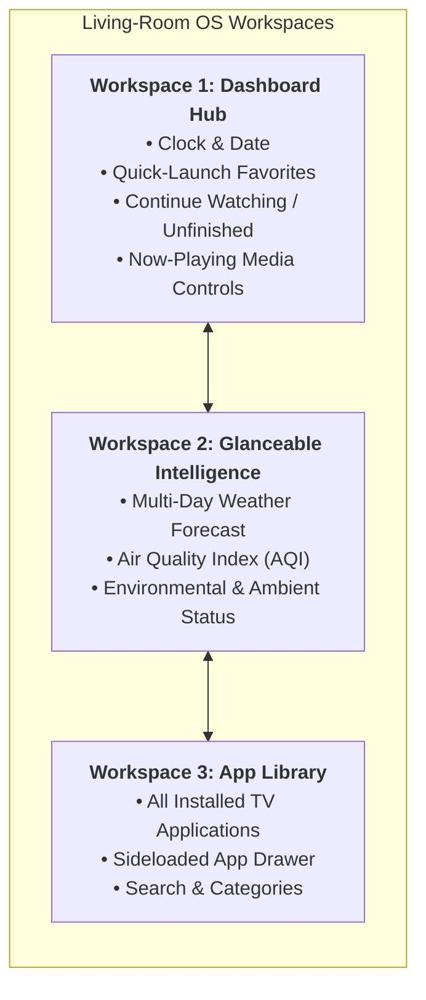
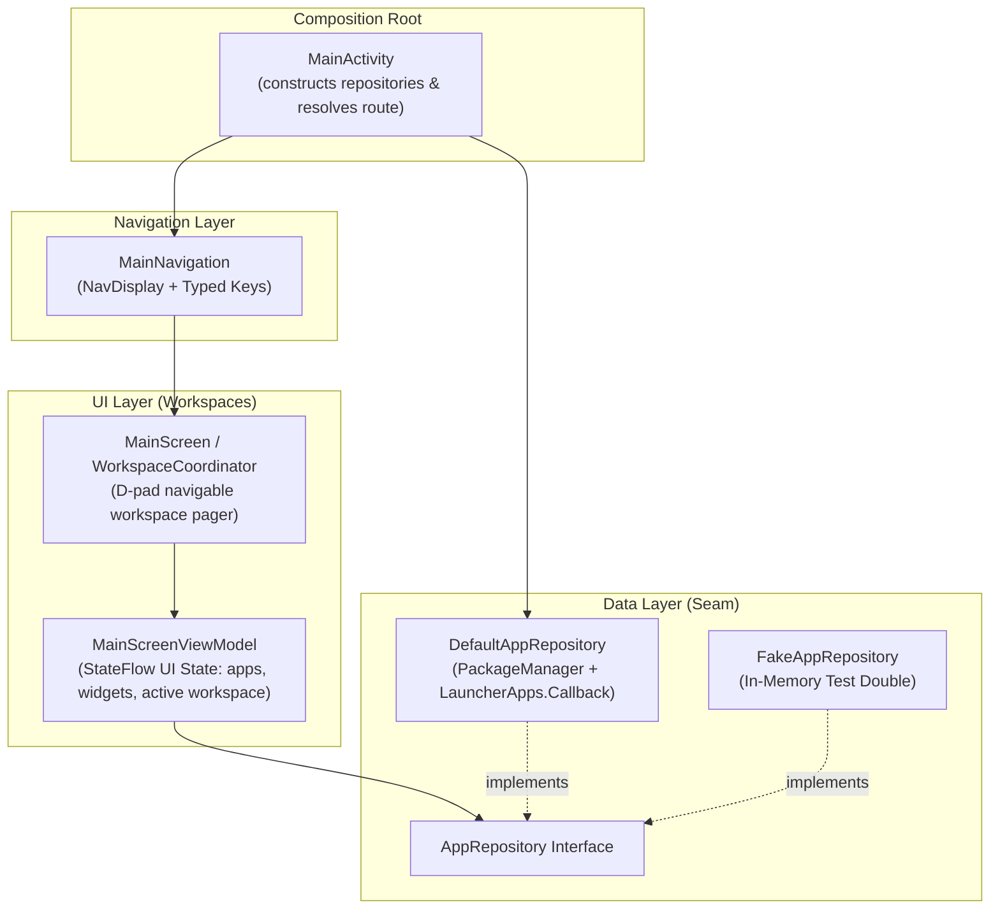

# MaigTV Architecture

## Overview
MaigTV is an ad-free, living-room OS-style interface designed for TV form factors across Android TV, Google TV, and Amazon Fire OS. Rather than functioning as a standard single-grid launcher, MaigTV is architected as an intuitive, multi-workspace living-room experience inspired by desktop window managers and virtual workspaces, purpose-built for 10-foot remote D-pad navigation.

It adheres strictly to the single source of truth principle, unidirectional data flow, constructor-injected seams, and TV accessibility guidelines.

---

## Workspace Model

The user experience is structured around fluid, horizontal or switchable **Workspaces**:



- **Workspace 1 (Dashboard Hub)**: The primary landing space for instantaneous utility — living-room clock, immediate resume/continue content, now-playing media card, and pinned favorite apps for zero-latency launching.
- **Workspace 2 (Glanceable Intelligence)**: A dedicated utility space providing deeper situational awareness (expanded weather forecasts, AQI, calendar/ambient widgets) without cluttering the primary app drawer.
- **Workspace 3 (App Library)**: A comprehensive, D-pad navigable catalog of all installed TV apps and sideloaded Android apps, powered by the reactive `AppRepository` seam.

---

## Directory & Package Tree

```
app/
├── src/main/
│   ├── AndroidManifest.xml          # TV launcher, LEANBACK_LAUNCHER, HOME intent filters, <queries>
│   └── kotlin/tv/maig/launcher/
│       ├── MainActivity.kt          # Composition root & deep-link route resolution
│       ├── Navigation.kt            # Navigation 3 NavDisplay & TV screen routing
│       ├── NavigationKeys.kt        # Typed navigation keys (Main, Settings)
│       ├── data/
│       │   └── AppRepository.kt     # Seam: TvAppInfo, AppRepository, DefaultAppRepository, FakeAppRepository
│       └── ui/
│           ├── main/
│           │   ├── MainScreen.kt          # Stateless TV launcher composable with focus semantics
│           │   └── MainScreenViewModel.kt # Unidirectional MVI StateFlow pipeline
│           └── theme/
│               ├── Color.kt         # TV color tokens
│               ├── Theme.kt         # Living-room dark color scheme & typography
│               └── Type.kt          # 10-foot scale typography
└── src/test/
    └── kotlin/tv/maig/launcher/
        ├── NavigationRouteTest.kt   # Deep link (maigtv://settings) & route resolution unit test
        └── ui/main/
            └── MainScreenViewModelTest.kt # StateFlow pipeline test with FakeAppRepository
```

---

## Seams & Dependency Direction



- **Composition Root (`MainActivity`)**: Instantiates concrete data repositories (`DefaultAppRepository`) at the system boundary and passes them into the composable tree via constructor injection. Resolves incoming deep-link intents into typed `NavKey` values.
- **UI Layer (`ui/main`)**: Observes immutable `StateFlow` from `MainScreenViewModel`. The UI coordinates between workspaces, receiving data and emitting callbacks (`onAppClick`, `onWorkspaceSelect`). Every interactive component meets the 48dp minimum target size and provides accessibility semantics for remote D-pads.
- **Data Layer (`data`)**: Defined behind `AppRepository`. Production code uses `DefaultAppRepository` (querying `PackageManager` for `CATEGORY_LEANBACK_LAUNCHER` and `CATEGORY_LAUNCHER`, and observing `LauncherApps.Callback` events), while unit tests and preview harnesses use `FakeAppRepository`. Domain contracts never depend on the UI framework.

---

## Libraries & Versions

Dependencies are managed via Gradle Version Catalog (`gradle/libs.versions.toml`):

| Library / Plugin | Version | Purpose |
| :--- | :--- | :--- |
| `com.android.application` | `9.5.1` | Android Gradle Plugin for compiling application |
| `org.jetbrains.kotlin.android` | `2.3.20` | Kotlin language compiler and runtime |
| `androidx.compose.bom` | `2026.03.01` | Bill of Materials for Compose runtime, UI, and foundation |
| `androidx.compose.material3` | BOM | Modern Material Design 3 components |
| `androidx.navigation3.runtime` / `ui` | `1.0.1` | Next-generation type-safe declarative navigation |
| `androidx.lifecycle:lifecycle-viewmodel-compose` | `2.10.0` | ViewModel integration with Compose lifecycle |
| `org.jetbrains.kotlinx:kotlinx-coroutines-test` | `1.10.2` | Coroutines testing harness |
| `junit:junit` | `4.13.2` | JVM unit testing |

---

## Build & Test Commands

```bash
# Inner Loop: compile Kotlin sources
./gradlew :app:compileDebugKotlin

# Inner Loop: run unit tests
./gradlew :app:testDebugUnitTest

# Full Verification Gate: test and package APK
./gradlew testDebugUnitTest assembleDebug
```
