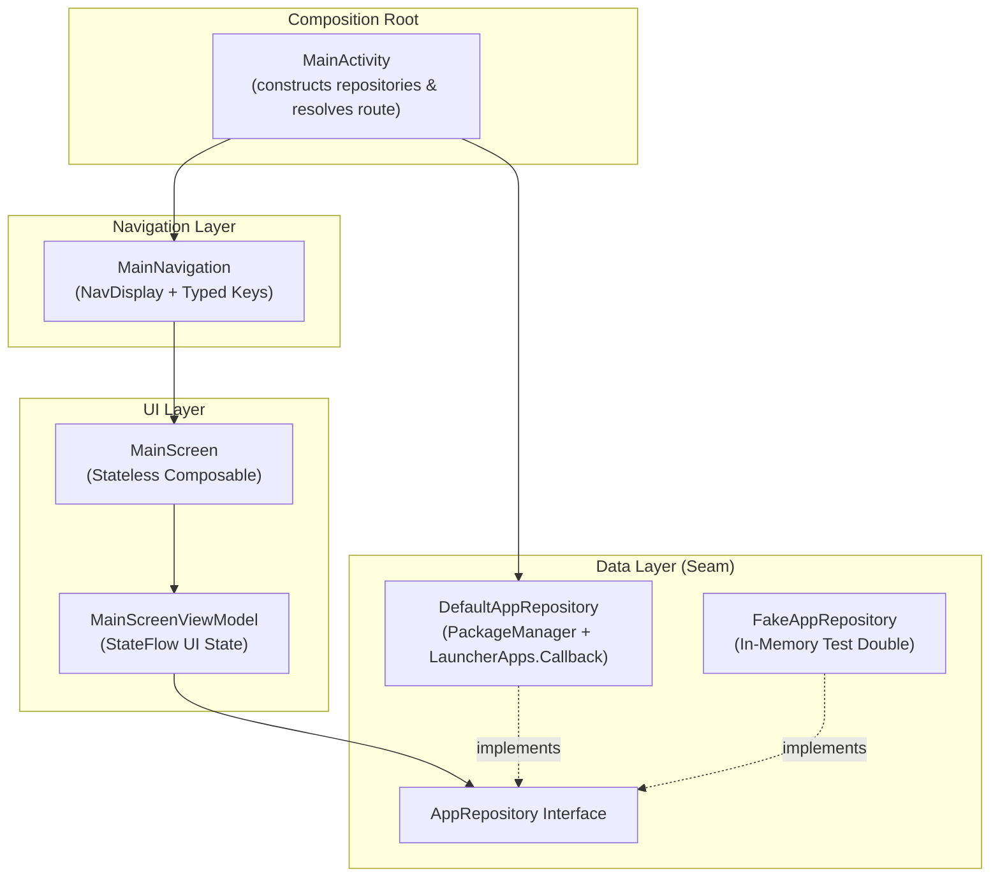

# MaigTV Architecture

## Overview
MaigTV is a lightweight, ad-free native launcher designed for TV form factors across Android TV, Google TV, and Amazon Fire OS. It adheres strictly to the single source of truth principle, unidirectional data flow, constructor-injected seams, and 10-foot TV accessibility guidelines.

---

## Directory & Package Tree

```
app/
├── src/main/
│   ├── AndroidManifest.xml          # TV launcher, LEANBACK_LAUNCHER, HOME intent filters, <queries>
│   └── kotlin/tv/maig/launcher/
│       ├── MainActivity.kt          # Composition root & deep-link route resolution
│       ├── Navigation.kt            # Navigation 3 NavDisplay & TV screen routing
│       ├── NavigationKeys.kt        # Typed navigation keys (Main, Settings)
│       ├── data/
│       │   └── AppRepository.kt     # Seam: TvAppInfo, AppRepository, DefaultAppRepository, FakeAppRepository
│       └── ui/
│           ├── main/
│           │   ├── MainScreen.kt          # Stateless TV launcher composable with focus semantics
│           │   └── MainScreenViewModel.kt # Unidirectional MVI StateFlow pipeline
│           └── theme/
│               ├── Color.kt         # TV color tokens
│               ├── Theme.kt         # Living-room dark color scheme & typography
│               └── Type.kt          # 10-foot scale typography
└── src/test/
    └── kotlin/tv/maig/launcher/
        ├── NavigationRouteTest.kt   # Deep link (maigtv://settings) & route resolution unit test
        └── ui/main/
            └── MainScreenViewModelTest.kt # StateFlow pipeline test with FakeAppRepository
```

---

## Seams & Dependency Direction



- **Composition Root (`MainActivity`)**: Instantiates concrete data repositories (`DefaultAppRepository`) at the system boundary and passes them into the composable tree via constructor injection. Resolves incoming deep-link intents into typed `NavKey` values.
- **UI Layer (`ui/main`)**: Observes immutable `StateFlow` from `MainScreenViewModel`. The UI is stateless, receiving data and emitting callbacks (`onAppClick`). Every interactive component meets the 48dp minimum target size and provides accessibility semantics for remote D-pads.
- **Data Layer (`data`)**: Defined behind `AppRepository`. Production code uses `DefaultAppRepository` (querying `PackageManager` for `CATEGORY_LEANBACK_LAUNCHER` and `CATEGORY_LAUNCHER`, and observing `LauncherApps.Callback` events), while unit tests and preview harnesses use `FakeAppRepository`. Domain contracts never depend on the UI framework.

---

## Libraries & Versions

Dependencies are managed via Gradle Version Catalog (`gradle/libs.versions.toml`):

| Library / Plugin | Version | Purpose |
| :--- | :--- | :--- |
| `com.android.application` | `9.0.1` | Android Gradle Plugin for compiling application |
| `org.jetbrains.kotlin.android` | `2.3.20` | Kotlin language compiler and runtime |
| `androidx.compose.bom` | `2026.03.01` | Bill of Materials for Compose runtime, UI, and foundation |
| `androidx.compose.material3` | BOM | Modern Material Design 3 components |
| `androidx.navigation3.runtime` / `ui` | `1.0.1` | Next-generation type-safe declarative navigation |
| `androidx.lifecycle:lifecycle-viewmodel-compose` | `2.10.0` | ViewModel integration with Compose lifecycle |
| `org.jetbrains.kotlinx:kotlinx-coroutines-test` | `1.10.2` | Coroutines testing harness |
| `junit:junit` | `4.13.2` | JVM unit testing |

---

## Build & Test Commands

```bash
# Inner Loop: compile Kotlin sources
./gradlew :app:compileDebugKotlin

# Inner Loop: run unit tests
./gradlew :app:testDebugUnitTest

# Full Verification Gate: test and package APK
./gradlew testDebugUnitTest assembleDebug
```
